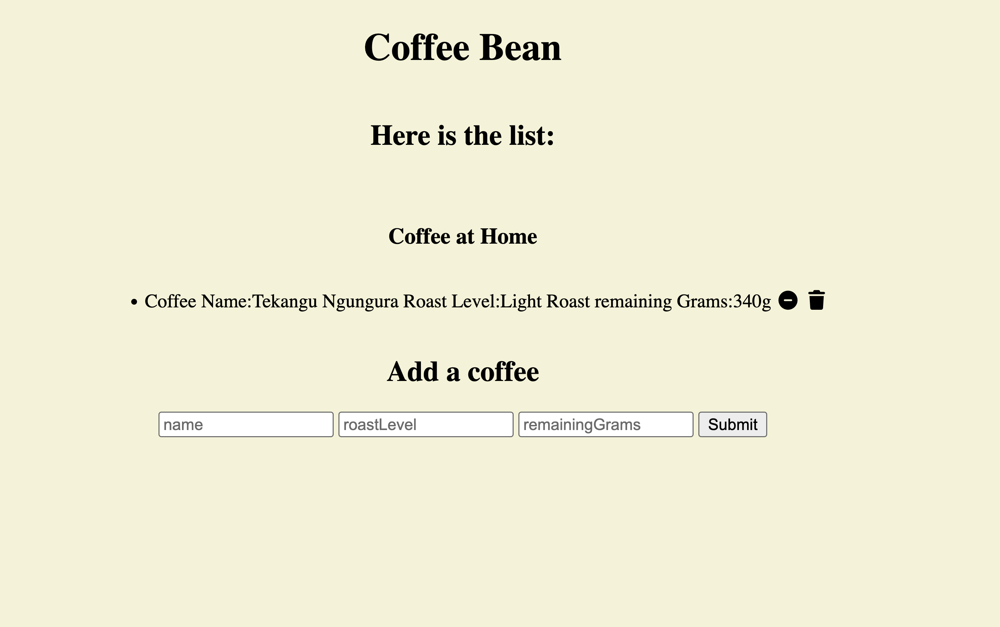
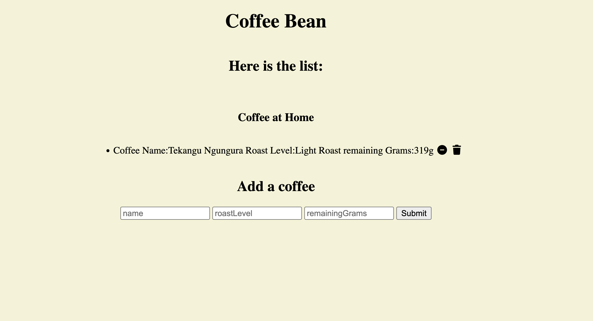

## Coffee Bean

Coffee Bean is  a place that user can enter their coffee bean name, roast level. User also can enter the weight of the coffee bag so that know when to restore the coffee.

## Demo
Check out here:
Live: [site](https://coffee-bean-mdvy.onrender.com)

## Features

- User can enter coffee bean name or origin, roast level and weights. 
- Once user makes coffee, they would click "minus" button, then it would auto subtract 21g which is bean amount for one shot of expresso.
- There is a delete button so user can remove coffee bean entry. 

## Built with

- Node.js and Express
- MongoDB with Mongoose
- EJS templates
- Plain JavaScript and CSS